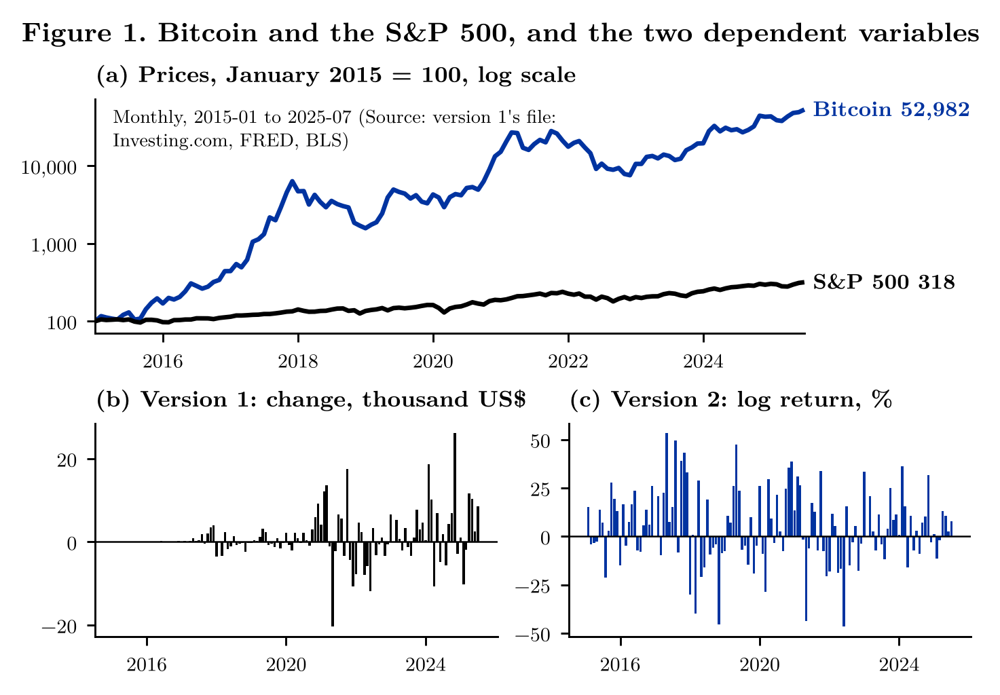
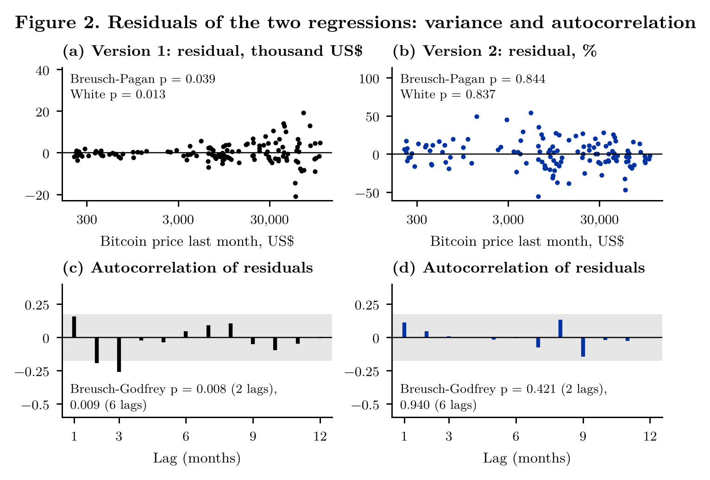
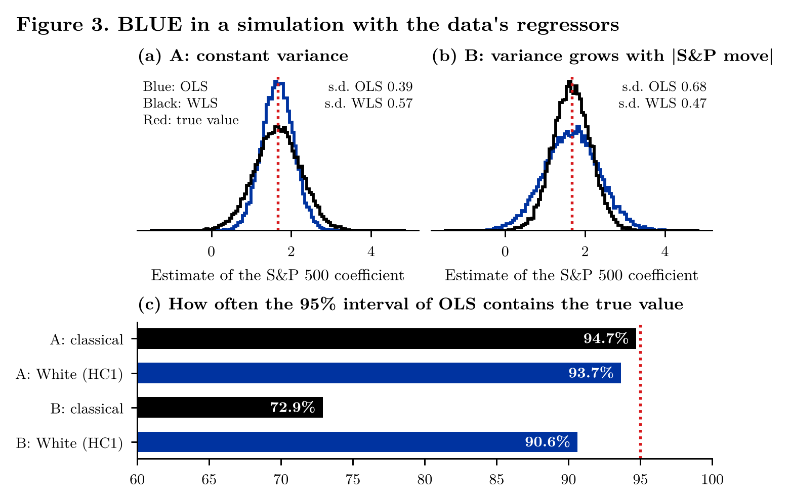
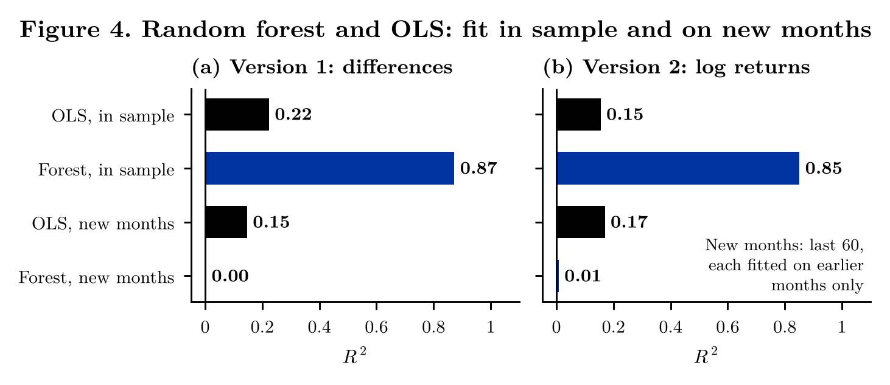

# bitcoin-macro-blueml: When Is OLS BLUE?

[](https://github.com/mikbalyilmaz/bitcoin-macro-blueml/actions/workflows/tests.yml)
[](LICENSE)

Version 2 of an application of undergraduate econometrics: the Gauss–Markov assumptions, checked one by one in a
regression of the monthly Bitcoin price change on gold, the S&P 500, the US dollar index, consumer prices and the
federal funds rate, January 2015 to July 2025.

Version 1 regressed the change of Bitcoin in US dollars on the changes of the other variables and found that OLS is
not BLUE. With the same data, version 2 shows that the failure comes from the form of the variables, not from
Bitcoin: in dollar changes the error variance grows with the price level and the residuals are autocorrelated; in
log returns none of the checks rejects its assumption.

The project note, [`paper/blue_note.pdf`](paper/blue_note.pdf), explains each step and writes out the mathematics.

## The theorem

In $y = X\beta + u$, if (A1) the model is linear in $\beta$, (A2) $X$ has full column rank, (A3)
$E[u \mid X] = 0$ and (A4) $\mathrm{Var}(u \mid X) = \sigma^2 I$, then OLS, $b = (X'X)^{-1}X'y$, has the smallest
variance among all estimators that are linear in $y$ and unbiased: it is the best linear unbiased estimator (BLUE).
Normality of $u$ is not one of the assumptions.

## Data and the form of the variables

The file of version 1, `data/dataset1.xlsx`: 127 months of Bitcoin, gold, the S&P 500 and the dollar index
(Investing.com), the effective federal funds rate (FRED) and the CPI-U (FRED in version 1's notebook, BLS in its
README). Version 1 uses first differences of the levels; version 2 uses monthly log returns in per cent,
monthly inflation and the change of the federal funds rate.

**Figure 1.** (a) Bitcoin and the S&P 500, January 2015 = 100, log scale. (b) Version 1's dependent variable, the
monthly change of Bitcoin in thousand US dollars: tens of dollars in 2015, tens of thousands in 2024. (c) Version 2's
dependent variable, the monthly log return.



## The assumptions, one by one

| Assumption | Check | Version 1: differences, $p$ | Version 2: log returns, $p$ |
|---|---|---|---|
| A1 linearity | RESET ($F$) | 0.569 | 0.356 |
| A2 no collinearity | largest VIF | 1.73 | 1.67 |
| A4 constant variance | Breusch–Pagan | 0.039 | 0.844 |
| A4 constant variance | White | 0.013 | 0.837 |
| A4 no autocorrelation | Breusch–Godfrey, 2 lags | 0.008 | 0.421 |
| A4 no autocorrelation | Breusch–Godfrey, 6 lags | 0.009 | 0.940 |
| not an assumption | Jarque–Bera (normality) | <0.001 | 0.079 |

A3 cannot be tested from the residuals. In version 2 only the S&P 500 is related to Bitcoin in the same month
(coefficient 1.67; standard error 0.39 classical, 0.36 White, 0.33 Newey–West); the other regressors have
$p \ge 0.27$, $R^2 = 0.155$.

**Figure 2.** Residuals of the two regressions. (a), (b) Against the Bitcoin price of the previous month: in
version 1 the spread grows with the price (rank correlation of the absolute residual with the price 0.57), in
version 2 it does not (−0.08). (c), (d) Autocorrelations of the residuals.



## What BLUE means, in a simulation

The regressors of version 2 are held fixed and 20,000 samples are drawn with (A) constant error variance and (B) an
error variance that grows with the size of the S&P 500 move, with the same average. OLS is compared with weighted
least squares, which is generalised least squares under B.

| Law | s.d. OLS | s.d. WLS | 95% interval of OLS covers, classical | White (HC1) |
|---|---|---|---|---|
| A: A4 holds | 0.39 | 0.57 | 94.7% | 93.7% |
| B: A4 fails | 0.68 | 0.47 | 72.9% | 90.6% |

Both estimators are unbiased under both laws. Under A, OLS has the smaller variance, as the theorem says; under B it
does not, and its classical intervals are too short.

**Figure 3.** (a), (b) Distribution of the two estimates of the S&P 500 coefficient under A and B. (c) Share of
samples in which the 95% interval of OLS contains the true value.



## The random forest

Version 1 reported $R^2 = 0.87$ for a random forest (500 trees). That is measured on the months the forest was
fitted on. Fitted on earlier months only and applied to each of the last 60 months (2020-08 to 2025-07), the forest
explains none of the variance ($R^2$ 0.00 for differences, 0.01 for log returns); OLS keeps 0.15 and 0.17.

**Figure 4.** $R^2$ of OLS and of the random forest in sample and on months not used in fitting.



All numbers are in `figures/*.csv` and in the project note.

## Contents

| Path | What it is |
|---|---|
| `blueml/data.py` | The dataset of version 1 with a monthly index; version 1's differences and version 2's log returns |
| `blueml/models.py` | OLS, the Gauss–Markov checks, classical, White and Newey–West standard errors, the Monte Carlo experiment, the random forest with expanding-window predictions |
| `blueml/legacy.py` | Runs the notebook of version 1 on the stored data, to reproduce its numbers |
| `blueml/style.py` | Figure style |
| `data/` | `dataset1.xlsx`, the file of version 1, unchanged |
| `tests/run_tests.py` | Unit tests against matrix formulas, auxiliary regressions written out, exact variances and the printed output of version 1 |
| `analysis/01_data.py` | Data, unit-root tests, Granger tests (Figure 1) |
| `analysis/02_ols.py` | Both regressions, the checks of A1–A4, standard errors (Figure 2) |
| `analysis/03_simulation.py` | OLS against weighted least squares with and without A4 (Figure 3) |
| `analysis/04_forest.py` | Random forest and OLS in sample and on new months (Figure 4) |
| `analysis/run_all.py` | Runs the four analyses in order (about two minutes) |
| `figures/` | Figures as PNG (300 dpi) and PDF, every reported table as CSV |
| `paper/` | Project note; `make_paper.py` writes all its numbers from `figures/*.csv` |
| `legacy/` | Version 1 (notebook, PDF and README), unchanged |
| `fonts/` | Latin Modern Roman (GUST Font License) |

## How to run

```
pip install -r requirements.txt
python tests/run_tests.py
cd analysis
python run_all.py
cd ../paper
python make_paper.py
xelatex blue_note.tex && xelatex blue_note.tex && xelatex blue_note.tex   # needs XeLaTeX; three runs settle the page numbers
```

## Changes from version 1

See [NEWS.md](NEWS.md): what was added and a table of the corrections to version 1.

## Citation

See [CITATION.cff](CITATION.cff), or:

> Yılmaz, M. İ. (2026). *bitcoin-macro-blueml: The Gauss–Markov assumptions in a regression of Bitcoin on
> macro-financial variables* (Version 2.0.0) [Computer software]. https://github.com/mikbalyilmaz/bitcoin-macro-blueml

## License

MIT, see [LICENSE](LICENSE).
